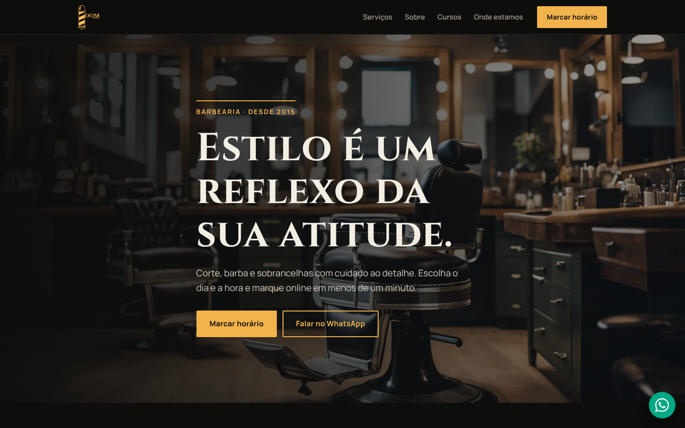

# Dom Barberss · Barbearia

Site da barbearia **Dom Barberss** (Portugal): serviços, marcação online pelo Calendly, cursos, localização e contactos.

🔗 **Site:** [dombarberss.netlify.app](https://dombarberss.netlify.app)

## O que tem

- **Marcação online** (Calendly) em destaque no topo, no hero e em cada serviço
- **Serviços:** corte, barba completa, corte e barba, sobrancelhas
- **Sobre**, com fotos de cortes reais feitos na barbearia
- **Cursos online**, com contacto direto pelo WhatsApp
- **Onde estamos:** mapa, link para o Google Maps e todos os contactos
- Botão flutuante do WhatsApp com mensagem já preenchida

## Versão 2 (o que mudou)

- Textos em português de Portugal e chamadas para ação claras ("Marcar horário")
- Identidade da marca mantida (preto e dourado do logótipo), com o logótipo em PNG transparente
- **Imagens otimizadas:** o projeto passou de 5,7 MB para cerca de 0,7 MB
- Código limpo: saíram CSS duplicados, fontes não usadas e as bibliotecas AOS e Boxicons
- SEO e partilha (descrição e imagem de pré-visualização), textos alternativos e foco visível

## Tecnologias

HTML · CSS · Netlify

## Autor

Site desenvolvido por **Anderson Frota** · [andersonfrota.netlify.app](https://andersonfrota.netlify.app) · [LinkedIn](https://www.linkedin.com/in/andersongfrota)
